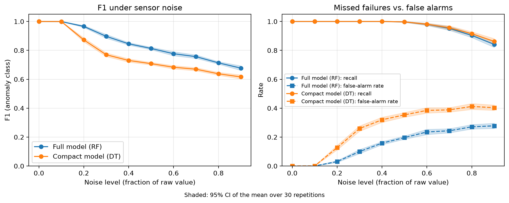

# Graceful Degradation of TinyML Inference on Microcontrollers

TinyML models on microcontrollers assume clean inputs and enough resources. In the field they face noisy or drifting sensors, memory pressure, bit flips and dropped connections, and they fail without warning, giving confident wrong answers. This project measures how badly that happens and builds a fallback cascade that keeps predictions reliable: a compact model under resource pressure, abstaining when uncertain, a peer quorum vote over a custom TCP protocol, and a conservative failsafe when the network is down.

**Status (Nov 2026):** the single-node degradation study is done. The Rust coordinator and peer quorum are in progress. ESP32 hardware validation is planned.

## First result: degradation under sensor noise



Bearing-failure classifiers compiled to fixed-point C, under multiplicative sensor noise (30 seeded repetitions per level, 95% CI):

- Both models are perfect up to 10% noise. At 90% noise, accuracy falls to 76% (random forest) and 68% (decision tree.
- Real failures are still almost always caught as recall stays near 1.0 until about 50% noise. The errors are false alarms on healthy readings that sit just below the decision threshold.
- The compact tree relies on a single feature and is measurably more fragile. That's the motivation for diverse peer models in the quorum.

Key details:

Data->NASA IMS bearing dataset, test 2, bearing 1 (984 one-second snapshots, 10 min apart). Labels: rows 0–529 normal, 530–699 dropped as transition, 700+ anomaly, final 2 shutdown rows dropped. The split is per-class and by time, with a 20-snapshot gap to prevent leakage between neighbouring snapshots.
Models->random forest (15 trees, depth 5) and decision tree (depth 3), compiled with emlearn. Features are scaled per feature into int16 using factors generated into `feature_scales.h`. C output matches Python on all 123 test rows.

## Reproducing the noise experiment

```bash
python -m venv .venv && source .venv/bin/activate
pip install pandas numpy scipy scikit-learn emlearn matplotlib kagglehub

python setup/data_download.py     # extract features from the IMS data
python setup/modeltraining.py     # train, export model_*.h and feature_scales.h
cd edge_nodes && make && ./main.out && cd ..   # writes backup_data/noise_results.csv
python analysis/noise_analysis.py # writes figures/e1_noise.{pdf,png}
```
